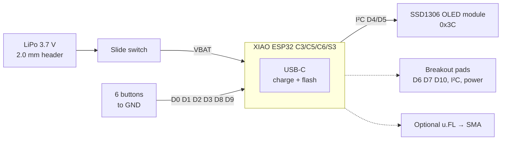
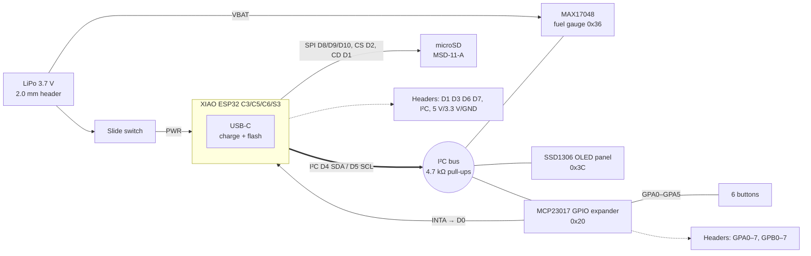

# Hardware overview

Splunkerboard is a carrier board for the [Seeed Studio XIAO](https://wiki.seeedstudio.com/SeeedStudio_XIAO_Series_Introduction/) ESP32 modules. The XIAO is surface-soldered (castellated pads) on top of the board. It provides the CPU, radio, USB-C, the 3.3 V regulator and the LiPo charger. Splunkerboard adds the display, input, storage and power parts around it.

← [Back to main README](../../README.md)

## Variants

| Variant | Codename / folder | Layers | Docs |
|---|---|---|---|
| **Splunkerboard Dev (V1B)**: compact base board, DIY-friendly | `Splunkerboard DIY/` | 2 | [splunkerboard-dev.md](splunkerboard-dev.md) |
| **Splunkerboard 1 (V1C)**: full prototyping board | `Splunker 1/` | 4 | [splunkerboard-1.md](splunkerboard-1.md) |
| **Expansion board**: prototyping add-on for Splunkerboard 1 | `Splunker 1 Prototyping Board/` | 4 | [expansion-board.md](expansion-board.md) |

Both main boards have the **same 47.1 × 79.4 mm outline** and **two Ø2.1 mm (M2) mounting holes**, so enclosures and the expansion board fit either one.

Planned product options (from `Splunker 1/Splunkerboard-Project.md`):

1. Dev module bare PCB
2. Dev DIY kit
3. Pre-assembled Splunkerboard Dev (V1B)
4. Splunkerboard 1 bare PCB
5. Splunkerboard 1 DIY kit
6. Pre-assembled Splunkerboard 1 (V1C)

## Block diagrams

### Splunkerboard Dev (V1B)

### Splunkerboard 1 (V1C)

## Compatible XIAO modules

Any XIAO with the standard footprint fits. Both main boards have **two overlapping XIAO footprints** (the ESP32-C3 and ESP32-C5 SMD variants), so both battery-pad layouts on the back of the module are covered.

| Module | Notes |
|---|---|
| XIAO ESP32-C3 | Single-core RISC-V, 2.4 GHz Wi-Fi + BLE 5. Gamecard targets this module. |
| XIAO ESP32-C5 | **Dual-band 2.4 / 5 GHz** Wi-Fi 6 + BLE 5. Sentinel and WarPet target this module. |
| XIAO ESP32-C6 | Wi-Fi 6, BLE 5, 802.15.4 (Thread/Zigbee) |
| XIAO ESP32-S3 | Dual-core Xtensa, more RAM, optional PSRAM |

The store listing also names the S5 and S6. Check their battery-pad layout against the footprints before relying on them.

## Shared design facts

| Item | Value |
|---|---|
| Logic level | 3.3 V (from the XIAO's regulator) |
| I²C bus | **D4 = SDA, D5 = SCL** (XIAO default `Wire` pins) |
| OLED | SSD1306, 128 × 64, I²C address `0x3C` |
| Battery | Single-cell 3.7 V LiPo, 2-pin **2.0 mm** pitch header (+ / −) |
| Charging | XIAO on-module charger, over USB-C |
| Power switch | C&K OS102011MA1Q right-angle SPDT slide switch, between the battery and the XIAO BAT pad |
| Buttons | 6 × XKB TS-1187A SMD tactile (Up, Down, Left, Right, OK, Back), active-low to GND |
| Passives | 0805 |
| Test points | Ø1.0 mm pads for every button line, SDA, SCL, 3V3 and GND |

## I²C address map

| Address | Device | Board |
|---|---|---|
| `0x20` | MCP23017 16-bit I/O expander | Splunkerboard 1 |
| `0x36` | MAX17048 LiPo fuel gauge | Splunkerboard 1 |
| `0x3C` | SSD1306 OLED | both |

`0x20`–`0x27`, `0x36` and `0x3C`/`0x3D` are taken. Choose other addresses for add-on sensors.

## Source files

| File | Purpose |
|---|---|
| `*.kicad_pro` | KiCad project |
| `*.kicad_sch` | Schematic |
| `*.kicad_pcb` | PCB layout |
| `Render-V1C-*.png` | Product renders (in `Splunker 1/`) |
| `*.stl`, `*.glb`, `*.blend*` | 3D models (see [manufacturing](manufacturing.md#3d-models-and-enclosure)) |

Local-only files (`*.kicad_prl`, `.history/`, `*.net`, KiCad backups and Blender `.blend1` backups) are excluded by the repository's [`.gitignore`](../../.gitignore).

The board-specific pages list the known issues and review notes.
